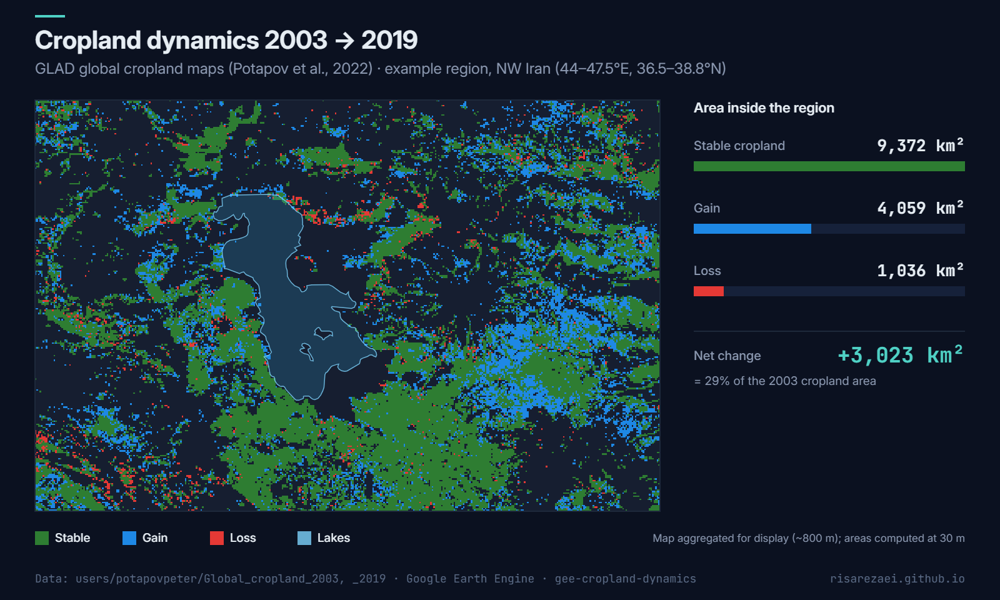

# Cropland Dynamics 2003–2019

Map where cropland **stayed**, **appeared** or **disappeared** between 2003 and 2019 at 30 m resolution, and measure how much area changed, for any region on Earth. Built on the GLAD global cropland maps (Potapov et al., 2022) in Google Earth Engine.

Example output: cropland change 2003 → 2019 around Lake Urmia, with area per class computed at 30 m.

## What the script does

| Class | Rule | Colour |
|---|---|---|
| **Stable** | cropland in 2003 **and** 2019 | green |
| **Gain** | cropland in 2019 only | blue |
| **Loss** | cropland in 2003 only | red |

It then:

- shows the classes on the map with a legend
- prints the area of each class (km²) inside your region of interest
- exports a 3-band binary GeoTIFF (`Stable`, `Gain`, `Loss`) and/or a single-band class map (`1` stable, `2` gain, `3` loss)

## Quick start

1. Open the [Earth Engine Code Editor](https://code.earthengine.google.com).
2. Paste [`cropland_dynamics.js`](cropland_dynamics.js) into a new script.
3. Set `CONFIG.roi` to your region: a drawn geometry, an asset, or a rectangle.
4. Press **Run**, then start the exports from the **Tasks** tab.

## Configuration

| Parameter | Default | Description |
|---|---|---|
| `roi` | example rectangle | Region for statistics and export |
| `exportStack` | `true` | Export the 3-band binary GeoTIFF |
| `exportClassMap` | `true` | Export the single-band class GeoTIFF |
| `computeAreas` | `true` | Print stable / gain / loss area in km² |
| `scale` | `30` | Resolution in metres (native 30 m) |

## Outputs

| File | Bands | Values |
|---|---|---|
| `cropland_dynamics_2003_2019_3bands.tif` | `Stable`, `Gain`, `Loss` | 1 / 0, masked outside cropland |
| `cropland_dynamics_2003_2019_classes.tif` | `class` | 1 stable · 2 gain · 3 loss |

Areas are computed with `ee.Image.pixelArea()`, so they are true surface areas, not pixel counts.

## Notes

- Non-cropland is set to 0 before the comparison, so gain and loss are evaluated everywhere and not only where both maps have data.
- Large regions (continents or the globe) can take a long time to export; reduce the ROI or raise `scale` for a quick look.

## Data and citation

Potapov, P., Turubanova, S., Hansen, M. C., et al. (2022). Global maps of cropland extent and change show accelerated cropland expansion in the twenty-first century. *Nature Food*, 3, 19–28. https://doi.org/10.1038/s43016-021-00429-z

## Author

**Parisa Abbasalizadehrezaei** · [risarezaei.github.io](https://risarezaei.github.io)

Released under the [MIT License](LICENSE).
